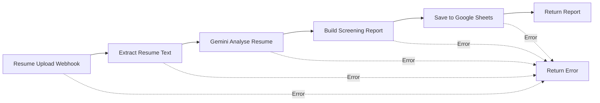

# AI-Powered Resume Screening Agent

An AI-assisted resume screening workflow built with **n8n**, **Google Gemini**, and **Google Sheets**. The workflow accepts a PDF resume and a job description, extracts resume text, evaluates the candidate against the role requirements, and saves a structured screening report.

> **Important:** This project is a decision-support tool. It does not make hiring decisions. A human recruiter must review the results and make the final decision.

---

## Table of Contents

- [Overview](#overview)
- [Features](#features)
- [Workflow Architecture](#workflow-architecture)
- [Technology Stack](#technology-stack)
- [How It Works](#how-it-works)
- [Screening Output](#screening-output)
- [Setup and Configuration](#setup-and-configuration)
- [Testing the Webhook](#testing-the-webhook)
- [Sample Test Resumes](#sample-test-resumes)
- [Google Sheets Structure](#google-sheets-structure)
- [Responsible AI and Privacy](#responsible-ai-and-privacy)
- [Limitations](#limitations)
- [Future Enhancements](#future-enhancements)
- [Repository Structure](#repository-structure)
- [Contributing](#contributing)
- [License](#license)

---

## Overview

Recruiters often receive many resumes for a single job opening. Reviewing each resume manually can take considerable time and may lead to inconsistent initial screening.

This project automates parts of the initial screening process. A recruiter submits a candidate's PDF resume and the relevant job description. Gemini AI analyses the extracted resume text and returns structured information, including candidate details, relevant skills, missing skills, and a job-match score. n8n processes the response and appends the result to a Google Sheets document.

The goal is to make initial resume review more organized and efficient while keeping the recruiter in control of all hiring decisions.

## Features

- **PDF resume upload** through an n8n webhook.
- **Automatic text extraction** from the uploaded PDF.
- **Job-specific evaluation** using a supplied job description.
- **AI-assisted candidate analysis** using Google Gemini.
- **Structured screening report** containing candidate details and evaluation results.
- **Match score and category** to support quick review.
- **Matching and missing skills** identified against the job requirements.
- **Automatic Google Sheets storage** for each submitted candidate.
- **JSON response** returned to the API caller.
- **Error-handling route** for workflow failures.
- **Individual resume processing:** the current workflow processes one resume per request.

## Workflow Architecture



### Workflow Components

| Step | n8n Node | Responsibility |
|---|---|---|
| 1 | Resume Upload | Receives the PDF resume and job description through an HTTP POST webhook. |
| 2 | Extract Resume Text | Extracts readable text from the uploaded PDF. |
| 3 | Gemini Analyse Resume | Compares the resume with the job description and generates structured analysis. |
| 4 | Build Screening Report | Uses JavaScript to parse and organize the AI response into report fields. |
| 5 | Save to Google Sheets | Appends the candidate's screening details to the `Candidates` sheet. |
| 6 | Return Report | Sends the screening report back as a JSON response. |
| Error route | Return Error | Provides an error response when a connected workflow step fails. |

## Technology Stack

| Technology | Purpose |
|---|---|
| [n8n](https://n8n.io/) | Workflow automation and orchestration |
| [Google Gemini](https://ai.google.dev/) | AI-based resume analysis |
| [Google Sheets](https://www.google.com/sheets/about/) | Stores candidate screening results |
| [Hoppscotch](https://hoppscotch.io/) | Sends test API requests and PDF files |
| JavaScript | Transforms and structures screening data |
| PDF extraction node in n8n | Extracts text from PDF resumes |
| Webhooks / HTTP POST | Accepts resume submissions and returns results |

## How It Works

1. **Resume submission:** The caller sends a PDF file to the n8n webhook using `multipart/form-data`. The job description is supplied as a request parameter.
2. **Text extraction:** The PDF extraction node reads the PDF and provides its text to the next step.
3. **AI analysis:** The workflow sends the extracted resume text and job description to Gemini.
4. **Candidate evaluation:** Gemini identifies relevant qualifications, technical skills, experience, projects, matching skills, missing skills, and an overall evaluation.
5. **Report construction:** A JavaScript Code node parses the model response and prepares consistent fields for storage.
6. **Data storage:** The Google Sheets node appends the result as a new row.
7. **API response:** The Respond to Webhook node returns the screening report in JSON format.

## Screening Output

The workflow is designed to return and store fields such as:

| Field | Description |
|---|---|
| Date | Date and time the screening record was created |
| Name | Candidate name extracted from the resume |
| Email | Candidate email address, if available |
| Phone | Candidate phone number, if available |
| Education | Education information found in the resume |
| Technical Skills | Relevant technical skills found in the resume |
| Work Experience | Relevant work experience |
| Projects | Projects listed in the resume |
| Score | AI-generated match score from 0 to 100 |
| Category | Screening category based on the configured score bands |
| Matching Skills | Skills that match the job description |
| Missing Skills | Relevant required skills not evidenced in the resume |
| Evaluation | Short explanation of the candidate's alignment with the role |

### Configured Score Categories

The current report-building logic uses these score bands:

| Score | Category |
|---:|---|
| 85–100 | Strong Match |
| 70–84 | Good Match |
| 50–69 | Moderate Match |
| Below 50 | Low Match |

These categories are configurable and should be treated as screening guidance, not a measure of a person's overall ability or potential.

## Setup and Configuration

### Prerequisites

You will need:

- An n8n instance (cloud or self-hosted).
- A Google Gemini API credential configured for the Gemini node.
- A Google account and a Google Sheets document.
- Hoppscotch or another API client for testing.
- A PDF resume to test the workflow.

### 1. Import or Create the n8n Workflow

Create the workflow with the nodes shown in the [Workflow Architecture](#workflow-architecture) section. If you share an exported n8n workflow JSON in this repository, remove credentials and other secrets before committing it.

### 2. Configure the Resume Webhook

Configure the **Resume Upload** webhook node:

- HTTP Method: `POST`
- Path: `resume-screening`
- Authentication: configure according to your deployment needs.
- Respond: `Using 'Respond to Webhook' Node`

The workflow uses a binary input field named `data` for the uploaded PDF.

### 3. Configure PDF Extraction

Configure the PDF extraction node to:

- Operation: `Extract From PDF`
- Input Binary Field: `data`
- Join Pages: enabled

### 4. Configure Gemini

Add your Gemini credential to the **Gemini Analyse Resume** node and select a model available to your account.

The prompt should pass both:
- The job description received by the webhook.
- The extracted resume text from the PDF extraction node.

The prompt should request evidence-based evaluation and structured JSON. Do not include API keys or private credentials in the prompt or repository.

### 5. Configure Google Sheets

Create or convert a Google spreadsheet and add a worksheet named `Candidates`.

Use columns corresponding to the screening fields:

`Date`, `Name`, `Email`, `Phone`, `Education`, `Technical Skills`, `Work Experience`, `Projects`, `Score`, `Category`, `Matching Skills`, `Missing Skills`, `Evaluation`

Connect the Google Sheets credential in n8n, select the spreadsheet and `Candidates` worksheet, and map each field from the **Build Screening Report** node.

### 6. Configure the Response Node

Set the **Return Report** node to respond with JSON and return the structured report produced by the Code node.

Check that the webhook node is configured to use the **Respond to Webhook** node.

### 7. Publish the Workflow

Test the complete workflow before publishing it. Once the test is successful, publish the workflow and use its **Production URL** for live requests. Keep the test URL for test-listener sessions only.

> The exact webhook URL depends on your n8n instance. Do not publish a private webhook URL in this README unless you intentionally want it to be public.

## Testing the Webhook

The workflow can be tested with Hoppscotch.

1. Open Hoppscotch and create a `POST` request.
2. Enter your n8n **Production Webhook URL** (or the test URL while listening for a test event).
3. Open **Body** and select `multipart/form-data`.
4. Add a field named `data`, choose the file type, and select one PDF resume.
5. Add the `job_description` parameter using the request configuration expected by your webhook. In the current setup, the job description is passed as a URL query parameter.
6. Click **Send**.
7. Review the JSON response.
8. Confirm that a new row appears in the Google Sheets `Candidates` worksheet.

### Example Job Descriptions

**Full Stack Developer**

```text
Looking for a Full Stack Developer with experience in JavaScript,
React, Node.js, REST APIs, SQL, and PostgreSQL. Practical project
or internship experience is preferred.
```

**Python Data Analyst**

```text
Looking for a Python Data Analyst with Python, SQL, Pandas,
data cleaning, data visualization, and analytical problem-solving skills.
```

**Java Backend Developer**

```text
Looking for a Java Backend Developer with Java, Spring Boot,
REST API development, SQL, database design, and Git experience.
```

**UI/UX Designer**

```text
Looking for a UI/UX Designer with Figma, wireframing, prototyping,
user research, visual design, and usability testing experience.
```

**DevOps / Cloud Intern**

```text
Looking for a DevOps or Cloud Intern with Linux, Git, Docker,
CI/CD fundamentals, cloud platform knowledge, and scripting skills.
```

### Current Upload Behaviour

The current workflow processes **one PDF resume per webhook request**. To screen several candidates, send a separate request for each resume. Batch or multi-file processing is a possible future enhancement.

## Sample Test Resumes

The project has been tested with fictional sample resumes representing different job profiles:

| Candidate | Sample Profile |
|---|---|
| Aarav Sharma | Full Stack Developer |
| Priya Nair | Python Data Analyst |
| Rohan Deshmukh | Java Backend Developer |
| Sana Khan | UI/UX Designer |
| Vikram Patel | DevOps / Cloud Intern |

These are fictional test profiles and should not be treated as real candidate records.

## Google Sheets Structure

The `Candidates` worksheet acts as a simple results store. Each successful screening request appends a new row containing the candidate information and AI-generated evaluation.

This makes it possible to:
- Review multiple screening results in one place.
- Sort or filter candidates by score or category.
- Compare matching and missing skills.
- Keep a basic record of screening activity.

Google Sheets is used here for simplicity and demonstration. A production recruitment system may require a database with stronger access controls, retention policies, and audit capabilities.

## Responsible AI and Privacy

Resume screening can affect people's employment opportunities. Use this project carefully.

- The AI should evaluate only job-relevant evidence such as skills, experience, education, and projects.
- Do not use protected or sensitive characteristics such as age, gender, race, religion, nationality, marital status, disability, or photographs to score candidates.
- A missing keyword does not necessarily mean a candidate lacks that skill; the resume may simply omit it.
- AI-generated scores can be inaccurate, incomplete, or inconsistent. Recruiters should review the underlying evidence.
- Do not use the score as the sole basis for rejecting or selecting a candidate.
- Obtain appropriate permission before processing personal data.
- Restrict access to resumes, webhook endpoints, credentials, and stored candidate information.
- Avoid uploading real candidate resumes to public repositories.
- Do not commit API keys, OAuth tokens, passwords, private webhook URLs, or personal candidate data.

## Limitations

- The current workflow handles one resume per request rather than batch uploads.
- PDF text extraction may not work well with scanned or image-only resumes unless OCR is added.
- The quality of the analysis depends on the resume content, job description, model, and prompt.
- AI-generated scores are estimates and are not validated hiring assessments.
- Google Sheets is a basic storage solution and may not be suitable for large-scale or sensitive recruitment operations.
- The workflow does not replace recruiter review, interviews, reference checks, or other hiring procedures.

## Future Enhancements

Potential improvements include:

- Batch upload and processing of multiple resumes.
- OCR support for scanned resumes.
- A dedicated recruiter dashboard.
- Candidate search, filtering, and ranking.
- Downloadable candidate reports.
- Email notifications after screening.
- Integration with applicant tracking systems.
- Database integration with role-based access control.
- Screening history and audit logs.
- Recruiter feedback to help evaluate and improve the workflow.
- More extensive testing for consistency, bias, and reliability.

These are proposed enhancements and are not represented as completed features.

## Repository Structure

A suggested GitHub repository structure:

```text
ai-resume-screening-agent/
├── README.md
├── workflow/
│   └── resume-screening-workflow.json
├── docs/
│   ├── architecture.png
│   └── screenshots/
│       ├── n8n-workflow.png
│       ├── hoppscotch-request.png
│       └── google-sheets-results.png
├── sample-resumes/
│   └── README.md
└── LICENSE
```

Only add the workflow export, screenshots, and sample files if you intend to share them. Remove credentials and personal data from all files before uploading.

## Contributing

Contributions, suggestions, and improvements are welcome.

1. Fork the repository.
2. Create a feature branch.
3. Make your changes.
4. Test the workflow with fictional or consented sample data.
5. Submit a pull request describing the changes.

## License

Choose a license before publishing this project. For example, you may use the MIT License by adding a `LICENSE` file containing its standard terms. Do not claim a license until that file has been added.

---

## Author

**Swarup Patil**  
B.Tech – Computer Science and Engineering

GitHub: `https://github.com/YOUR-USERNAME`

---

If you find this project useful, consider giving the repository a ⭐ on GitHub.
